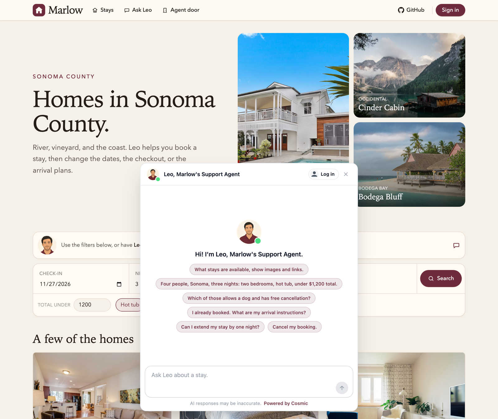

# Marlow

A demo vacation-rental site in Sonoma County, with a door for AI agents. Bookings and payments are simulated.

[Live site](https://marlow.cosmic.site) · [Ask Leo](https://marlow.cosmic.site/chat) · [Check the door](https://conciergeprotocol.org/check?domain=https://marlow.cosmic.site/)

<p align="center">
  
</p>

Homes, guests, and stays are Cosmic objects. Leo is the Cosmic support agent. A person in the chat and a visiting agent at the door reach the same agent. Login is what lets Leo read one guest's reservation. Arrival instructions are stored on the stay, not on the public home.

All content and AI support context is powered by [Cosmic](https://www.cosmicjs.com/community/projects/marlow).

## Try it

The bar at the bottom of the [live site](https://marlow.cosmic.site) is Leo. These need no login:

- What stays are available, show images and links.
- Four people, Sonoma, three nights: two bedrooms, hot tub, under $1,200 total.
- Which of those allows a dog and has free cancellation?

Demo guests are `maya` / `maya` (Orchard House) and `sam` / `sam` (Cliff Kitchen).

- I already booked. What are my arrival instructions?
- Can I extend my stay by one night?
- Can we check out at noon?
- Cancel my booking.
- Book River Lookout, Nov 20 to 23, with a dog.

Booking, extending, and cancelling wait for the guest to approve. Noon checkout is applied when the login is allowed to make changes. A read-only login can see the stay and cannot change it. When the number of guests is left out, the quote uses 2.

## The door

Marlow speaks the [Concierge Agent Protocol](https://conciergeprotocol.org). A visiting agent reads one file, sends the person's question, and gets a reply from the catalog or, after login, from that guest's reservation. Tools and keys stay on this server.

Every page sends `Link: </agent.txt>; rel="agent"`. The live file is [agent.txt](https://marlow.cosmic.site/agent.txt):

```text
Protocol: CAP/1.0
Name: Leo, Marlow's concierge
Ask: This site's agent answers questions for the company. POST your question to the CAP URL plus /messages, as JSON {"message": "...", "accept": ["items"]}, with headers CAP-Version: 1.0 and CAP-From: agent:{your-id}. If you can only open URLs, open the CAP URL. If the reply is 202, see Spec.
Chat: https://marlow.cosmic.site/chat
CAP: https://marlow.cosmic.site/cap/v1
OAuth: https://marlow.cosmic.site/oauth
Spec: https://conciergeprotocol.org/cap.txt
```

`Chat` is the page a person uses. `CAP` is where another agent posts. `OAuth` is the device login for account questions. `"accept": ["items"]` also returns a typed listing for each home. The reply is complete without it. [llms.txt](https://marlow.cosmic.site/llms.txt) lists the public pages. The door is separate from that list.

```bash
curl -s https://marlow.cosmic.site/agent.txt

curl -s https://marlow.cosmic.site/cap/v1/messages \
  -H 'content-type: application/json' \
  -H 'CAP-Version: 1.0' \
  -H 'CAP-From: agent:marlow-test' \
  -d '{"message":"What can you help me with?","accept":["items"]}'
```

`CAP-Version` and `CAP-From` are required. A reply that is still running returns `202` with `Retry-After`. Poll `GET /cap/v1/messages/{id}` until `status` is `done`.

From an MCP client:

```bash
npx @conciergeprotocol/mcp
# CAP_ENDPOINT=https://marlow.cosmic.site/cap/v1/messages
# CAP_FROM=agent:marlow-test
```

A question about "my stay" returns `login_required`. The visiting agent starts the device login, the guest approves it on this site, and the token is bound to that agent's `CAP-From`. Changing a stay needs a login that allowed changes. Otherwise the reply is `write_required`.

A catalog question that names dates, guests, bedrooms, a hot tub, dogs, or a budget is answered from the homes on this site, with a link to each house. Other public questions are sent to Leo. If Leo does not answer, that same search is the fallback.

Check a deployed door at [conciergeprotocol.org/check](https://conciergeprotocol.org/check?domain=https://marlow.cosmic.site/). The same steps are on [/test](https://marlow.cosmic.site/test).

With the bucket keys set, the door stores logins, tokens, messages, and approvals as `cap-records` objects in Cosmic, so it runs on serverless hosting. Without them it uses `data/cap.sqlite`.

## Run

```bash
cp .env.example .env
bun install
bun run seed
bun run check
bun run dev
```

Open http://localhost:3220. Ask Leo at http://localhost:3220/chat. The chat only answers if this origin is on Leo's allowed websites. For local work that is `http://localhost:3220`.

`bun run reset` puts both demo stays back to confirmed, without noon checkout or an extra night, in Cosmic and in the local `data/bookings.json` fallback. Dates are counted from the day they were saved.

`bun run seed` writes the homes, the fee and cancellation pages, the two guests, their stays, and the `cap-records` type into the Cosmic bucket named by `COSMIC_BUCKET_SLUG`. The site reads those homes when the read key is set, and uses the copy in the repo if the bucket cannot be reached.

`bun run check` covers search, fees, and the guest portal. It does not call Leo.

`CAP_PUBLIC_KEY` is the `ck_` key used to ask Leo public questions. `NEXT_PUBLIC_CHAT_EMBED_KEY` is the `pk_` key from his website install.

## Leo's account API

In the website install, set the account base URL to `<site>/api/account` and add these endpoints:

| Name | Method | Path |
| --- | --- | --- |
| `book_stay` | POST | `/stays` |
| `list_stays` | GET | `/stays` |
| `get_stay` | GET | `/stays/:id` |
| `noon_checkout` | POST | `/stays/:id/noon-checkout` |
| `extend_stay` | POST | `/stays/:id/extend` |
| `cancel_stay` | POST | `/stays/:id/cancel` |

`book_stay` takes JSON: `property` (the home name), `check_in` (`YYYY-MM-DD`), `nights`, `guests`, and `dogs`. It returns an approval link and does not reserve the stay until the guest opens it.

## Deploy on Vercel

Import the repo, then set every variable in `.env.example`. `NEXT_PUBLIC_SITE_URL` is the production origin, and `SESSION_SECRET` is a new random value (`openssl rand -base64 32`). The site refuses to sign sessions in production without it. Run `bun run seed` once against the bucket, add the production origin to Leo's allowed websites, and point his account base URL at it.
